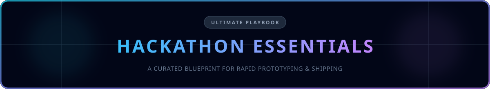
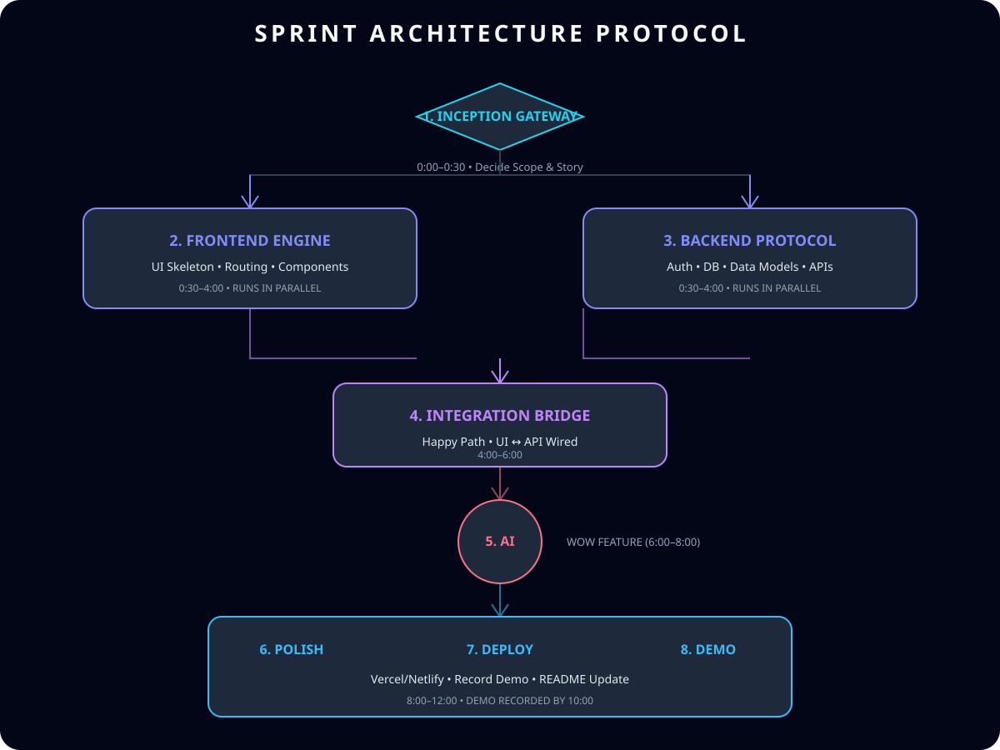

<a id="readme-top"></a>

<div align="center">
  
</div>

<div align="center">
  
</div>

<br />

<div align="center">
  
  
  
  
  
</div>

<p align="center">
  Welcome to the ultimate resource playbook for your next hackathon! This guide is sprinkled with Pokémon companions to keep your spirits high, your focus razor-sharp, and your pipeline shipping at warp speed.
</p>

<div align="center">
  <p>
    <a href="#flow"><b>⚡ FLOW</b></a> • 
    <a href="#frontend"><b>🎨 FRONTEND</b></a> • 
    <a href="#backend"><b>⚙️ BACKEND</b></a> • 
    <a href="#ai"><b>🧠 AI & ML</b></a> • 
    <a href="#apis"><b>🌐 APIS</b></a> • 
    <a href="#presentations"><b>📊 PRESENTATIONS</b></a> • 
    <a href="#deployment"><b>💎 DEPLOYMENT</b></a> • 
    <a href="#architecture"><b>🕒 ARCHITECTURE</b></a> • 
    <a href="#pro-tips"><b>💡 PRO-TIPS</b></a> • 
    <a href="#pokedex"><b>🎮 POKÉDEX</b></a> • 
    <a href="#maintainer"><b>🙋‍♂️ MAINTAINER</b></a>
  </p>
  <p>
    <a href="https://aadityaaaaa.vercel.app"></a>
  </p>
</div>

<div align="center">
  
</div>

> [!IMPORTANT]
> **GOAL: SHIP A WORKING DEMO FAST**
> These tools reduce "blank screen" time, eliminate infrastructure headaches, speed up high-fidelity prototyping, and secure a public deployment without getting stuck.

<div align="center">
  
</div>

<a id="flow"></a>

## ⚡ Quick Navigation & Flow
How to pick tools fast and build modularly during a sprint:

| Step | When | Move | Grab From |
| :---: | :---: | :--- | :--- |
| **01** | `0:30–4:00` | **UI first** — generate screens so the client is clickable immediately. | [🎨 Frontend](#frontend) |
| **02** | `0:30–4:00` | **Backend in parallel** — one unified Auth + DB provider. Never hand-roll auth. | [⚙️ Backend](#backend) |
| **03** | `6:00–8:00` | **AI only if it powers the core flow** — prompt ➔ actionable output. | [🧠 AI & ML](#ai) |
| **04** | `from 4:00` | **Test APIs early** — don't spend the last hour debugging payloads. | [🌐 APIs](#apis) |
| **05** | `0:00 & 9:30` | **Deploy early, deploy often** — live URL in hour one, release build at 9:30. | [💎 Deployment](#deployment) |

> [!TIP]
> Full hour-by-hour plan ➔ [🕒 12-Hour Sprint Architecture](#architecture)

<p align="right"><a href="#readme-top">⬆ back to top</a></p>

<div align="center">
  
</div>

<a id="frontend"></a>

## 🎨 Frontend / UI 

| Tool | Direct Link | Capabilities & Sprint Advantage |
| :--- | :--- | :--- |
| 🧩 **v0** | [v0.app](https://v0.app/) | **AI Code Gen:** Instantly spin up polished React & Tailwind codebases from text prompts. |
| ✍️ **Uizard** | [uizard.io](https://uizard.io/) | **Rapid Wireframing:** Transform raw physical sketches directly into clean, clickable UI flows. |
| 🧠 **Locofy.ai** | [locofy.ai](https://locofy.ai/) | **Figma-to-Code:** Seamlessly convert existing Figma visual assets into production-ready web code. |
| 🗺️ **Relume** | [relume.io](https://relume.io/) | **Site Architect:** Map visual site architecture and structural component blocks before styling. |
| 🧱 **TeleportHQ** | [teleporthq.io](https://teleporthq.io/) | **Visual Builder:** Assemble layouts quickly via visual drag-and-drop with clean code export. |
| 🎛️ **Builder.io** | [builder.io](https://www.builder.io/) | **Visual CMS:** Empower non-technical teammates to fine-tune copy and layouts in real-time. |

> [!TIP]
> Prioritize building a bulletproof **Happy Path** (Login ➔ Primary Action ➔ Output/Result). Perfecting minor edge cases is less important than a smooth main demo flow.

<p align="right"><a href="#readme-top">⬆ back to top</a></p>

<div align="center">
  
</div>

<a id="backend"></a>

## ⚙️ Backend / Full-Stack 

| Tool | Direct Link | Capabilities & Sprint Advantage |
| :--- | :--- | :--- |
| ⚡ **Bolt.new** | [bolt.new](https://bolt.new/) | **Instant Full-Stack:** Scaffold, run, and iterate entire full-stack apps inside the browser from a single prompt. |
| 💻 **Replit AI** | [replit.com](https://replit.com/) | **Cloud IDE:** Zero-config cloud IDE featuring live multiplayer coding and instant, one-click deployments. |
| ⚡ **Supabase** | [supabase.com](https://supabase.com/) | **BaaS Powerhouse:** Real-time Postgres database, secure JWT Auth, File Storage, and auto-generated REST APIs. |
| 🚊 **Railway** | [railway.com](https://railway.com/) | **App Deployer:** Deploy servers, background workers, and managed databases with zero infrastructure friction. |
| 🤖 **Claude Code** | [claude.com/claude-code](https://claude.com/claude-code) | **AI Coding Agent:** Plans, edits, runs tests, and commits across your whole repo from the terminal or IDE — a second engineer for the sprint. |
| 🖱️ **Cursor** | [cursor.com](https://cursor.com/) | **AI Code Editor:** VS Code fork with codebase-aware chat, multi-file edits, and background agents. |
| 📦 **Appwrite** | [appwrite.io](https://appwrite.io/) | **Self-Hosted BaaS:** Unified backend platform giving you complete control over your auth, files, and DB schemas. |

> [!TIP]
> Stick to a single unified backend system (e.g. Supabase). Introducing multiple backends leads to significant friction and integration delay.

<p align="right"><a href="#readme-top">⬆ back to top</a></p>

<div align="center">
  
</div>

<a id="ai"></a>

## 🧠 AI & Machine Learning 

| Tool | Direct Link | Capabilities & Sprint Advantage |
| :--- | :--- | :--- |
| 🤖 **OpenAI** | [openai.com](https://platform.openai.com/) | **Omni Intelligence:** Latest GPT models for reasoning, chat agents, and tool use, plus GPT Image for image generation. |
| 🧠 **Claude** | [claude.com](https://claude.com/) | **Deep Reasoning:** Claude Opus 5.5 / Sonnet 5.5 / Haiku 5.5 for long-context analysis, agentic coding (Claude Code), and complex logic. |
| ✨ **Google AI Studio** | [aistudio.google.com](https://aistudio.google.com/) | **Gemini API:** Free-tier API key in seconds for multimodal Gemini models (text, image, video, audio input). |
| 🤗 **Hugging Face** | [huggingface.co](https://huggingface.co/) | **Model Hub:** Access millions of open-source models, pre-trained weights, and instant interactive space demos. |
| 🎬 **Replicate** | [replicate.com](https://replicate.com/) | **Model APIs:** Deploy state-of-the-art image, video, and audio generation models over simple, scale-on-demand APIs. |

> [!TIP]
> Ensure your AI feature has a distinct, immediate feedback loop (e.g., input file ➔ get actionable intelligence summary) to maximize demo impact.

<p align="right"><a href="#readme-top">⬆ back to top</a></p>

<div align="center">
  
</div>

<a id="apis"></a>

## 🌐 APIs & Tools 

| Tool | Direct Link | Capabilities & Sprint Advantage |
| :--- | :--- | :--- |
| 🔌 **RapidAPI** | [rapidapi.com](https://rapidapi.com/) | **API Marketplace:** Millions of pre-built, ready-to-use public APIs to easily add advanced features (e.g. weather, finance). |
| 📮 **Postman** | [postman.com](https://postman.com/) | **API Workspace:** Standardized workspace for team testing, sharing API collections, and verifying mock endpoints. |
| 🪝 **Webhook.site** | [webhook.site](https://webhook.site/) | **Webhook Inspector:** Debug incoming HTTP requests and webhook payloads in real-time without hosting a receiver server. |

<p align="right"><a href="#readme-top">⬆ back to top</a></p>

<div align="center">
  
</div>

<a id="presentations"></a>

## 📊 Data & Presentations 

| Tool | Direct Link | Capabilities & Sprint Advantage |
| :--- | :--- | :--- |
| 🪄 **Gamma.app** | [gamma.app](https://gamma.app/) | **AI Presentations:** Generate beautifully designed, highly structured pitch decks in seconds from a simple text outline. |
| 🎨 **Canva** | [canva.com](https://canva.com/) | **Visual Suite:** Access rich mockups, pitch decks, infographics, and dynamic brand assets with intuitive AI tools. |
| 📈 **Chart.js** | [chartjs.org](https://www.chartjs.org/) | **Visual Metrics:** Simple, clean, and interactive HTML5-canvas charts to easily show off mock database stats. |

<p align="right"><a href="#readme-top">⬆ back to top</a></p>

<div align="center">
  
</div>

<a id="deployment"></a>

## 💎 Free Tiers for Deployment 

> [!IMPORTANT]
> Free tier limits are subject to change. Always verify usage limits and runtime cold starts shortly before your demo presentation.

| Platform | Database / Storage | Ideal Use Case & Free-Tier Catch |
| :--- | :--- | :--- |
| 📐 **Vercel** | Supabase (Postgres) | **Next.js & Frontend:** Seamless, ultra-fast global CDN edge hosting with direct integration for Postgres. |
| ◈ **Netlify** | MongoDB Atlas (NoSQL) | **Static & SPA Apps:** Simple visual deploy for static sites, Single Page Apps, and serverless background functions. |
| ☁️ **Render** | Managed Postgres / Key Value | **Web Apps & Services:** API servers with git-push deploys. ⚠️ Free services sleep after ~15 min idle (~1 min cold start); free Postgres expires after 30 days. |
| 🧡 **Cloudflare Pages** | Cloudflare D1 / R2 | **Edge Performance:** Unmatched global edge performance, static assets scaling, and zero-cost serverless workers. |
| 🐙 **GitHub Pages** | Static Only (No DB) | **Docs & Prototypes:** Easiest, zero-config method to host documentation pages directly from your project repository. |
| 🎈 **Fly.io** | Managed PostgreSQL | **Full-Stack Containers:** Run Docker containers close to users. ⚠️ No free tier for new orgs — short trial only, card needed after. |
| 🚊 **Railway** | Fully Managed DBs | **Unified Monolith:** One dashboard for services, workers, and databases. ⚠️ Trial credit only; Hobby plan ~$5/mo after. |
| 🟢 **Neon** | Serverless Postgres | **Database Only:** Free Postgres that scales to zero, with instant DB branches per preview deploy. Pairs with Vercel / Netlify / Cloudflare. |

> [!TIP]
> If your demo is frontend-only, host it on **GitHub Pages** or **Cloudflare Pages** right away to secure a public URL. Need a backend for free? **Vercel/Netlify functions + Neon or Supabase** is the safest zero-cost combo — no sleep, no expiring DB.

<p align="right"><a href="#readme-top">⬆ back to top</a></p>

<div align="center">
  
</div>

<a id="architecture"></a>

## 🕒 12-Hour Sprint Architecture 
A time-phased technical workflow for shipping hackathon MVPs.

<div align="center">
  
</div>

1. **0:00–0:30 — Decide scope (0.5h):** Single user story + maximum of 3 frontend views. Deploy a "Hello World" right away.
2. **0:30–4:00 — UI skeleton (3.5h, parallel):** Generate UI elements, wire routes, mock placeholders, and build empty states.
3. **0:30–4:00 — Backend (3.5h, parallel):** Wire authentication/database models, structure schemas, and spin up 3–5 secure endpoints.
4. **4:00–6:00 — Happy path (2h):** Complete end-to-end client-server integration with form validation & loading states.
5. **6:00–8:00 — One “wow” feature (2h):** Integrate AI or a high-impact external API (Input ➔ Intelligent Output).
6. **8:00–9:30 — Polish (1.5h):** Harden the critical path, clean layout gaps, and improve error messages.
7. **9:30–10:00 — Final deploy (0.5h):** Push the release build and re-test all production environment variables.
8. **10:00–12:00 — Demo & submit (2h):** Record the demo video first, then finish README, pitch deck, and submission — leftover time is buffer.

> [!NOTE]
> Total: **12 hours**. Steps 2 and 3 run in parallel, so split the team between them.

<p align="right"><a href="#readme-top">⬆ back to top</a></p>

<div align="center">
  
</div>

<a id="pro-tips"></a>

## 💡 Hackathon Pro-Tips Checklist
> [!TIP]
> Keep this checklist open during your sprint to ensure your team stays on the fast track to a winning submission.

- [ ] **Lock down the MVP scope in 30 minutes.** Anything not built in the first 6 hours is probably not making the final cut.
- [ ] **Set up public CDNs early.** Ensure you deploy a "Hello World" to Vercel/Netlify in the first 2 hours so you can test env vars live.
- [ ] **Design for high-fidelity mocks.** Judges spend less than 3 minutes on each project; a gorgeous UI and clear charts make a huge impression.
- [ ] **Record a demo video 2 hours before the deadline.** Never rely on live network signals during the actual presentation.

<p align="right"><a href="#readme-top">⬆ back to top</a></p>

<div align="center">
  
</div>

<a id="pokedex"></a>

## 🎮 Hackathon Pokédex: Sprint Companions

| Companion | Poké-Type | Phase / Section | Special Ability & Role |
| :--- | :--- | :--- | :--- |
|  | ⚡ Electric | **12-Hour Sprint Architecture** | **Lightning Speed:** Charges up team momentum to ship the MVP protocol in exactly 12 hours. |
|  | 🍃 Grass | **Frontend / UI Design** | **Vine Whip Layout:** Helps spin up beautiful, responsive layouts and wireframes in minutes. |
|  | 🔥 Fire | **Backend & Full-Stack** | **Ember Database:** Ignites backend engines with Supabase and secure data orchestration. |
|  | 🔮 Psychic | **AI & Machine Learning** | **Neural Mind:** Seamlessly integrates cognitive AI models and smart agents into the user loop. |
|  | 💧 Water | **APIs & Webhooks** | **Bubble Jet Pipes:** Routes external payloads, webhook events, and REST request channels. |
|  | 🐉 Dragon | **Data & Presentations** | **Hyper Beam Pitch:** Builds high-impact slide decks and charts to wow hackathon judges. |
|  | ✨ Normal | **Free Tiers & Deployment** | **Adaptability:** Rapidly mutates and deploys to static host CDNs, Edge pages, or container clouds. |

<p align="right"><a href="#readme-top">⬆ back to top</a></p>

<div align="center">
  
</div>

<a id="maintainer"></a>

## 🙋‍♂️ About the Maintainer 

<div align="center">
  
  <h3><b>AADITYA JAISWAR</b></h3>
  <p><i>"Build systems that think, scale, and heal — one commit at a time."</i></p>
  <p>
    <a href="https://aadityaaaaa.vercel.app"><b>🌐 aadityaaaaa.vercel.app</b></a><br />
    <sub>Projects, case studies, and everything I've shipped — come say hi.</sub>
  </p>

  [](https://aadityaaaaa.vercel.app)
  [](https://www.linkedin.com/in/aadityaaaaa)
  [](https://www.github.com/aad1tyaaaaa)
  [](mailto:aadityaaaaa.jaiswar@gmail.com)
  [](https://www.buymeacoffee.com/aadityaaaaa)
</div>

<br />

### 🛠️ Core Tech Radar & Systems Profile

```python
# System Profile
currently_building = {
    "AI Systems"        : ["LangGraph stateful agents", "RAG pipelines", "FAISS vector memory"],
    "Backend Infra"     : ["Event-driven microservices", "Kafka streams", "Async task queues"],
    "IoT & Healthcare"  : ["Real-time wearable data ingestion", "HIPAA-compliant architectures"],
    "Frontend"          : ["Next.js dashboards", "Flutter cross-platform apps"]
}

expertise = [
    "Multi-Agent LLM Systems",       # LangGraph, LangChain, Groq (Llama-3)
    "Full-Stack Engineering",         # React, Next.js, Django, FastAPI, Flutter
    "Distributed Systems",            # Kafka, Celery, Redis, WebSockets
    "RAG & Vector Search",            # FAISS, Supabase, semantic retrieval
    "MLOps & LLM Fine-Tuning",        # HuggingFace PEFT, LoRA, Airflow
    "Cloud & Container Orchestration" # Docker, Kubernetes, AWS, GCP, GitHub Actions
]

open_to = ["SDE Roles", "AI/ML Engineering", "Full-Stack Opportunities"]
```

<br />

<div align="center">
  
  <p><b>Rip It</b></p>
</div>

<div align="center">
  
  <p>
    <sub>Made with ⚡ by <a href="https://aadityaaaaa.vercel.app"><b>Aaditya Jaiswar</b></a> · If this playbook helped you ship, drop a ⭐</sub>
  </p>
  <p><a href="#readme-top">⬆ back to top</a></p>
</div>
